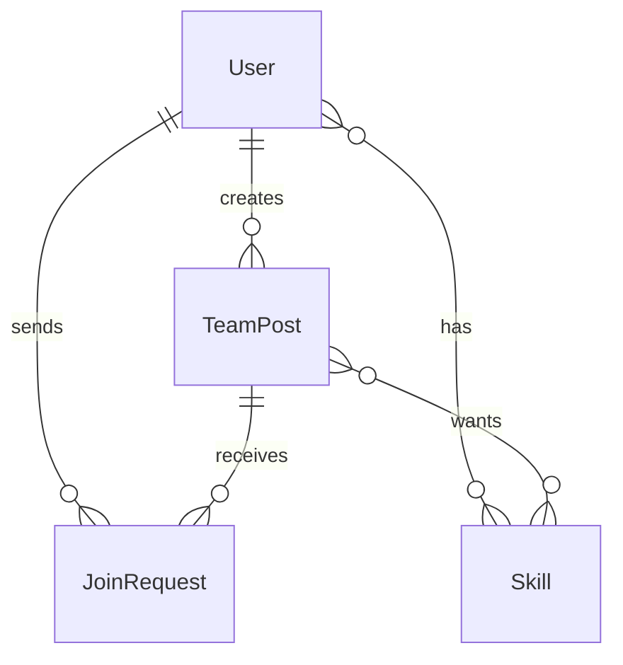

# Database Design

## User Entity

A user is a UI student with an account. Each user has one profile, so the profile fields live on the user row.

| Field                    | Data Type              | Required | Description                                          |
| :----------------------- | :--------------------- | :------- | :--------------------------------------------------- |
| `id`                     | Integer                | Yes      | Primary key                                          |
| `name`                   | String                 | Yes      | Display name                                         |
| `email`                  | String, unique         | Yes      | Login email, must end with `ui.ac.id`                |
| `password_hash`          | String                 | Yes      | Werkzeug password hash, never the plain password     |
| `faculty`                | String                 | Yes      | Faculty of the student                               |
| `study_program`          | String                 | Yes      | Study program (prodi)                                |
| `class_year`             | Integer                | Yes      | Year of admission (angkatan)                         |
| `bio`                    | String, Text, nullable | No       | Short self-introduction                              |
| `contact`                | String                 | Yes      | Contact for teammates, for example a WhatsApp number |
| `competition_experience` | String, Text, nullable | No       | Past competitions and results                        |

## Skill Entity

A skill is a shared label that users have and posts look for.

| Field  | Data Type      | Required | Description                            |
| :----- | :------------- | :------- | :------------------------------------- |
| `id`   | Integer        | Yes      | Primary key                            |
| `name` | String, unique | Yes      | Skill name, for example `UI/UX Design` |

## TeamPost Entity

A team post describes one competition and the teammates its owner is looking for.

| Field              | Data Type         | Required | Description                                                |
| :----------------- | :---------------- | :------- | :--------------------------------------------------------- |
| `id`               | Integer           | Yes      | Primary key                                                |
| `owner_id`         | Integer           | Yes      | Foreign key to `User.id`, the student who created the post |
| `competition_name` | String            | Yes      | Name of the competition                                    |
| `organizer`        | String, nullable  | No       | Organizer of the competition                               |
| `category`         | String            | Yes      | Competition category, chosen from a fixed list             |
| `description`      | String, Text      | Yes      | What the team is building and who it needs                 |
| `info_link`        | String, nullable  | No       | Link to the competition information page                   |
| `deadline`         | Date              | Yes      | Registration deadline of the competition                   |
| `slots_needed`     | Integer           | Yes      | Number of members wanted, at least 1                       |
| `wanted_faculties` | String, nullable  | No       | Faculty names, separated by commas                         |
| `status`           | Enum `PostStatus` | Yes      | `open` or `closed`                                         |
| `created_at`       | DateTime          | Yes      | Timestamp when the post was created                        |

## JoinRequest Entity

A join request is one student's application to one team post.

| Field          | Data Type            | Required | Description                                       |
| :------------- | :------------------- | :------- | :------------------------------------------------ |
| `id`           | Integer              | Yes      | Primary key                                       |
| `post_id`      | Integer              | Yes      | Foreign key to `TeamPost.id`                      |
| `applicant_id` | Integer              | Yes      | Foreign key to `User.id`, the student who applies |
| `message`      | String, Text         | Yes      | Short message from the applicant                  |
| `status`       | Enum `RequestStatus` | Yes      | `pending`, `accepted`, or `rejected`              |
| `created_at`   | DateTime             | Yes      | Timestamp when the request was sent               |

## Association Tables

Two tables join skills to the entities above. They hold no other data and have no model class of their own.

| Table        | Columns               | Description                  |
| :----------- | :-------------------- | :--------------------------- |
| `user_skill` | `user_id`, `skill_id` | Skills a user has            |
| `post_skill` | `post_id`, `skill_id` | Skills a post is looking for |

Each pair of columns is the primary key of its table, so a skill is never added twice.

## Enumerations

| Enum            | Values                            |
| :-------------- | :-------------------------------- |
| `PostStatus`    | `open`, `closed`                  |
| `RequestStatus` | `pending`, `accepted`, `rejected` |

Category and faculty values are fixed lists kept as tuples in the code (values TBD). The form shows them as dropdowns, and the filters use the same lists.

## Relationships

- **User to TeamPost:** One user can create many posts. `TeamPost.owner_id` identifies the owner for edit and close checks.
- **User to JoinRequest:** One user can send many requests, but only one per post. `JoinRequest.applicant_id` identifies the applicant.
- **TeamPost to JoinRequest:** One post receives many requests. `JoinRequest.post_id` identifies the post.
- **User to Skill:** Many-to-many through `user_skill`.
- **TeamPost to Skill:** Many-to-many through `post_skill`.

## Business Rules

| Rule            | Detail                                                                                                                                      |
| :-------------- | :------------------------------------------------------------------------------------------------------------------------------------------ |
| Team membership | A team is the post owner plus every applicant whose request is `accepted`. The database does not store it; it is derived from the requests. |
| Slots           | Remaining slots equal `slots_needed` minus the accepted requests. At zero, `status` changes to `closed`.                                    |
| Request limits  | A unique constraint on `post_id` and `applicant_id` allows one request per student per post. An owner cannot apply to their own post.       |
| Permissions     | Only the owner can edit or close a post and accept or reject its requests.                                                                  |
| Contact privacy | `User.contact` is shown only between members of the same team after acceptance.                                                             |
| Email           | `email` must end with `ui.ac.id` and is unique.                                                                                             |

## Schema and Model Mapping

Flask-SQLAlchemy turns each model class into one table, using the class name in snake case.

| Model         | Table          |
| :------------ | :------------- |
| `User`        | `user`         |
| `Skill`       | `skill`        |
| `TeamPost`    | `team_post`    |
| `JoinRequest` | `join_request` |

The skills of a user or post are read through a relationship attribute on the model, not through the association table directly. The remaining fields use the same names as their database columns.

(Storage: SQLite file at `instance/temutim.db`, created automatically on first run. `models.py` changes only after all three members agree. Seed data: `seed.py`.)

